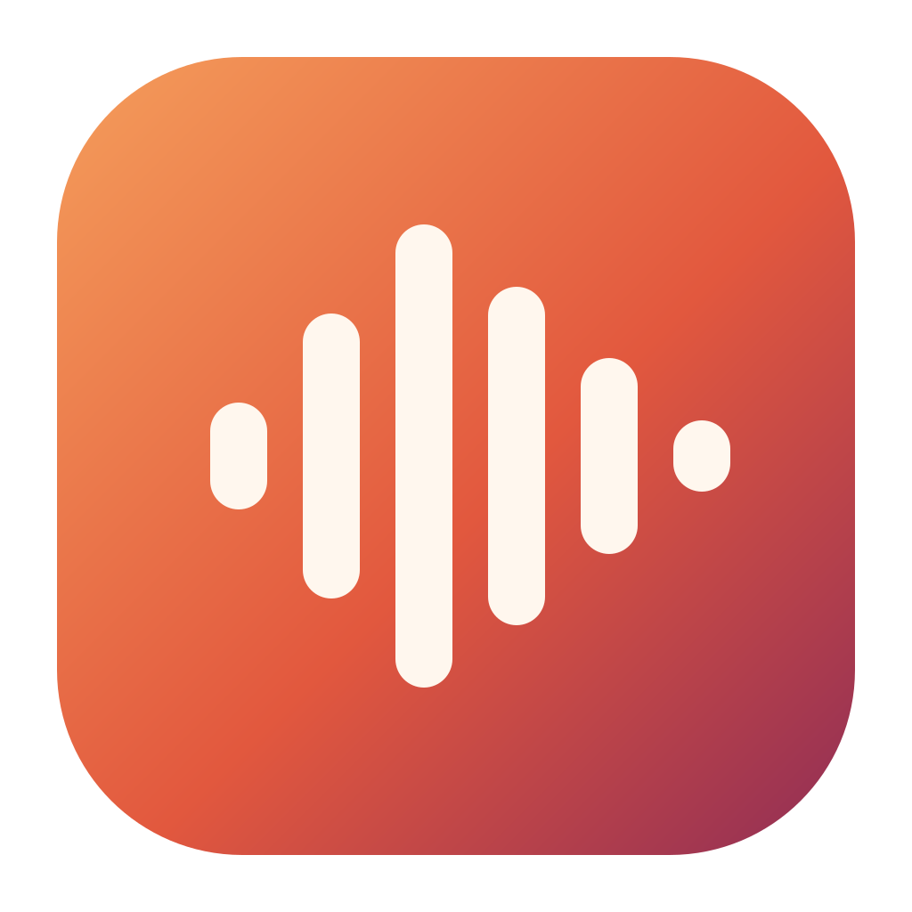

<p align="center">
  
</p>

<h1 align="center">Cover Studio</h1>

<p align="center">
  Turn a home-recorded music cover into something you can post.<br/>
  Separation, gentle tuning, mix and master, audio/video sync, take picking, social video, thumbnail and caption,<br/>
  all local, in a desktop app written in Rust.
</p>

---

You recorded a cover with your phone, or with a microphone while your phone filmed. Cover Studio opens
the files and then:

- **Separates voice and instrument** with MDX-Net (ONNX), so each part can be processed on its own.
- **Tunes the voice gently**: it tracks the pitch with RMVPE, detects the key and the instrument's tuning
  reference, and builds a smooth correction curve per *note*. Natural vibrato, deliberate slides and attacks are
  kept, while off-pitch notes, slow drift, sagging note endings and overshoots are corrected (retune speed,
  drift, vibrato calming), with formant preservation so the timbre stays yours.
- **Cleans and polishes the voice**: light denoising, mouth-click and plosive repair, breath control,
  a phrase leveler, a dynamic EQ for harshness (2–5 kHz) and mud (300 Hz), resonance suppression,
  an adaptive de-esser and a short vocal plate.
- **Mixes and masters**: vocal presence and air; an EQ per instrument (acoustic, classical, electric,
  piano, ukulele, band); glue compression, warmth and a small room. It normalises to the
  streaming loudness of your choice (−14 LUFS by default, true-peak limited).
  Only the *difference* between the processed and raw stems is added back to the original. Nothing
  separation-related leaks into the parts the model got wrong.
- **Syncs a separate audio recording to the video** by cross-correlating the two sound tracks.
  Offset and confidence are shown, and you can nudge the offset by hand.
- **Finds the takes**. It detects each attempt in a long recording, ranks them, and lets you drag the range on the timeline.
- **Exports**: WAV/FLAC/M4A/MP3 masters, a 9:16 / 1:1 / 16:9 video with correct colours (HDR phone footage
  is tone-mapped to SDR), a thumbnail with title, and a ready-to-paste caption in French or English with hashtags.
- **Compares**: A/B between the original and the processed version at matched loudness.

Everything runs on your machine. Nothing is uploaded. With an NVIDIA GPU, a three-minute song is analysed and
rendered in under 20 seconds. On CPU it still works, just slower.

## Install

Pre-built packages are attached to each [GitHub release](../../releases):

| Platform | Package | Notes |
| --- | --- | --- |
| Linux | `.AppImage`, `.deb` | Needs `ffmpeg` on the `PATH` (the `.deb` depends on it). |
| Windows 10/11 | `-setup.exe` | `ffmpeg` is bundled. |

On first launch, Cover Studio downloads the models it needs (≈ 500 MB, once).
If you have an NVIDIA GPU, open **Settings → GPU acceleration** to download the CUDA runtime.
That is ≈ 1.3 GB of NVIDIA's redistributable libraries, stored in your user folder, and no system-wide CUDA install
is required (only a recent NVIDIA driver).

## Using it

1. Drop a video and/or an audio file on the home screen. Use two files when the sound was recorded separately.
2. Cover Studio analyses the recording: separation, pitch, key, takes and sync. The editor then opens on the best take.
3. Pick a sound preset (*Natural*, *Balanced*, *Polished*) and the instrument, adjust the tuning, and listen
   with **Space**, switching between original and studio with **B**.
4. Choose the video format and look, set the title and artist for the thumbnail and caption, and export.

### Command line

The same engine is available as a CLI, for batch work or headless machines:

```sh
# One shot: analyse and export everything next to your music folder
cover-studio process cover.mp4 --title "Mockingbird" --artist "Eminem" --instrument acoustic

# Separate audio recording synced to the video, second take, square video, English caption
cover-studio process --video phone.mov --audio mic.wav --take 2 --aspect square --lang en

# Step by step on an existing project
cover-studio projects
cover-studio render <project> --preset polished --tuning 0.9
cover-studio render <project> --retune-speed 0.2 --vibrato 0.5 --leveler 0.7 --breath 0.5 --vocal-reverb 0.1
cover-studio export <project> --formats wav,flac --no-video

cover-studio info      # toolchain, GPU and model status
cover-studio models    # pre-download models
cover-studio gpu       # download the CUDA runtime
```

Run `cover-studio <command> --help` for every option.

### Where things are stored

| What | Linux | Windows |
| --- | --- | --- |
| Projects and their cache | `~/.local/share/cover-studio/projects` | `%APPDATA%\cover-studio\data\projects` |
| Models | `~/.cache/cover-studio/models` | `%LOCALAPPDATA%\cover-studio\cache\models` |
| CUDA runtime | `~/.local/share/cover-studio/gpu-runtime` | `%APPDATA%\cover-studio\data\gpu-runtime` |
| Exports (default) | `~/Music/Cover Studio/<project>` | `Music\Cover Studio\<project>` |

`COVER_STUDIO_PROJECTS`, `COVER_STUDIO_MODELS` and `COVER_STUDIO_CUDA_DIR` override the first three.

## Models and licences

Models are not part of this repository or the installers. They are downloaded on demand from their
upstream location, and each file is checked against a pinned SHA-256.

| Model | Used for | Source | Licence |
| --- | --- | --- | --- |
| UVR-MDX-NET Voc FT | vocal / accompaniment separation (default) | [Ultimate Vocal Remover model repo](https://github.com/TRvlvr/model_repo) | Published by the UVR project for free use; no separate licence file. Check upstream before commercial use. |
| UVR-MDX-NET Inst HQ 3 | instrument-focused separation | same | same |
| RMVPE | vocal pitch tracking and key detection | [lj1995/VoiceConversionWebUI](https://huggingface.co/lj1995/VoiceConversionWebUI) | Distributed with the RVC project (MIT). |

Other third-party components:

- [ONNX Runtime](https://github.com/microsoft/onnxruntime) (MIT), through the [`ort`](https://ort.pyke.io) crate.
  The CUDA execution-provider libraries ship next to the executable.
- NVIDIA CUDA, cuBLAS, cuFFT, cuRAND, NVRTC, nvJitLink and cuDNN. These are downloaded at the user's request from
  NVIDIA's official PyPI wheels and are covered by the NVIDIA software licence agreements bundled in those wheels.
  They are not redistributed by this project.
- [Signalsmith Stretch](https://github.com/Signalsmith-Audio/signalsmith-stretch) (MIT) for pitch shifting.
- [FFmpeg](https://ffmpeg.org) for decoding and encoding. It runs as a separate program. The Windows installer ships
  a GPL build from [BtbN/FFmpeg-Builds](https://github.com/BtbN/FFmpeg-Builds) with its licence; the source is available upstream.
- [Lato](https://www.latofonts.com) (SIL Open Font License 1.1) for thumbnails; see `crates/cover-engine/assets/fonts/OFL.txt`.

Your covers are your responsibility. Check the rights on the song before publishing.

## How it works

```
master audio ──► MDX-Net ──► vocals ──► RMVPE ─► notes ─► tuning curve ─► Signalsmith ─► vocal chain ─┐
     │                  └──► accompaniment ─────────────────────────────────► instrument EQ ─────────┤
     │                                                                                                ▼
     └──────────────────────────────── original + (processed − raw) ─► bus ─► room ─► loudness ─► master
video audio ─► cross-correlation with master ─► offset ─► ffmpeg (crop, tone-map, grade, NVENC/x264) ─► mp4
```

Analysis results (stems, pitch, takes, sync) are cached per project and keyed by the inputs and settings that affect them.
Changing the mix only re-renders the mix. Changing the take or the separation model re-runs only the parts that depend on it.

## Building from source

Requirements: Rust (stable), Node 24 with pnpm, and ffmpeg. On Linux, you also need the WebKitGTK development packages:

```sh
sudo apt install libwebkit2gtk-4.1-dev libsoup-3.0-dev libjavascriptcoregtk-4.1-dev \
  libayatana-appindicator3-dev librsvg2-dev ffmpeg
```

```sh
pnpm install
pnpm dev                          # desktop app with hot reload
pnpm build                        # desktop bundles for your platform
cargo run --release -p cover-cli -- info
cargo test
```

The UI also runs in a plain browser (`pnpm ui:dev`, http://localhost:3210) against a built-in mock of the engine.
This is handy for working on the interface without Rust.

```
crates/
  cover-dsp      pure DSP: filters, dynamics, loudness, pitch shift, tuning, key, take and sync analysis
  cover-media    ffmpeg/ffprobe wrappers: probing, decoding, frames, video rendering, audio encoding
  cover-ml       ONNX models: registry and downloads, MDX-Net, RMVPE, CUDA runtime installer
  cover-engine   projects, settings, caching, render pipeline, exports, thumbnails and captions
  cover-cli      the `cover-studio` command
apps/desktop/
  src-tauri      Tauri shell: commands, job events, file access
  ui             Next.js (static export) interface
```

Releases are built by `.github/workflows/release.yml` when a `v*` tag is pushed.

## Licence

Cover Studio is dual-licensed under [MIT](LICENSE-MIT) or [Apache-2.0](LICENSE-APACHE), at your option.
Third-party models and libraries keep their own licences, listed above.
